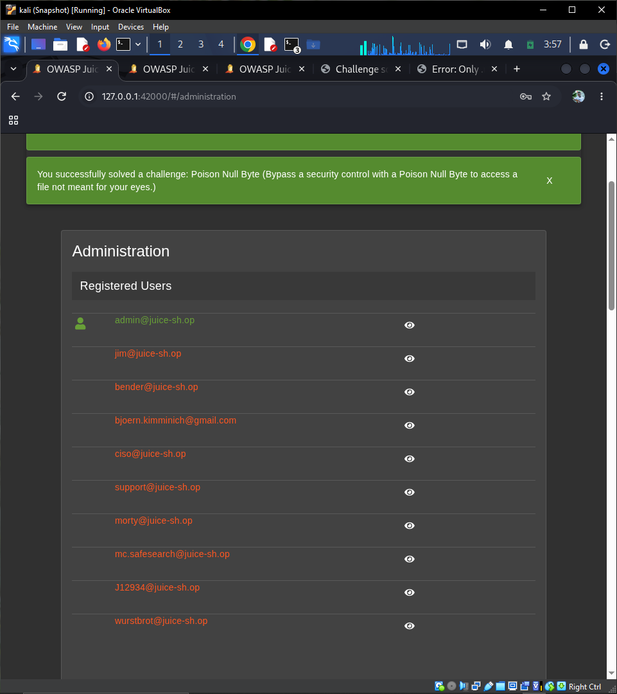
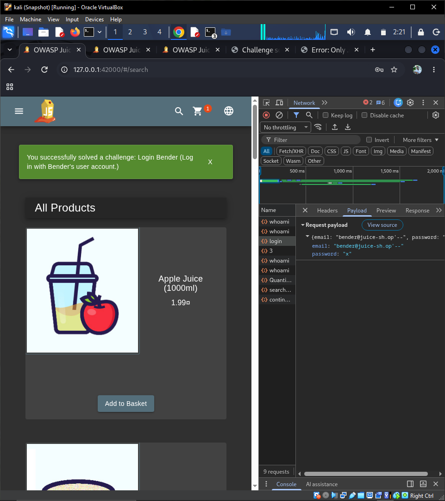
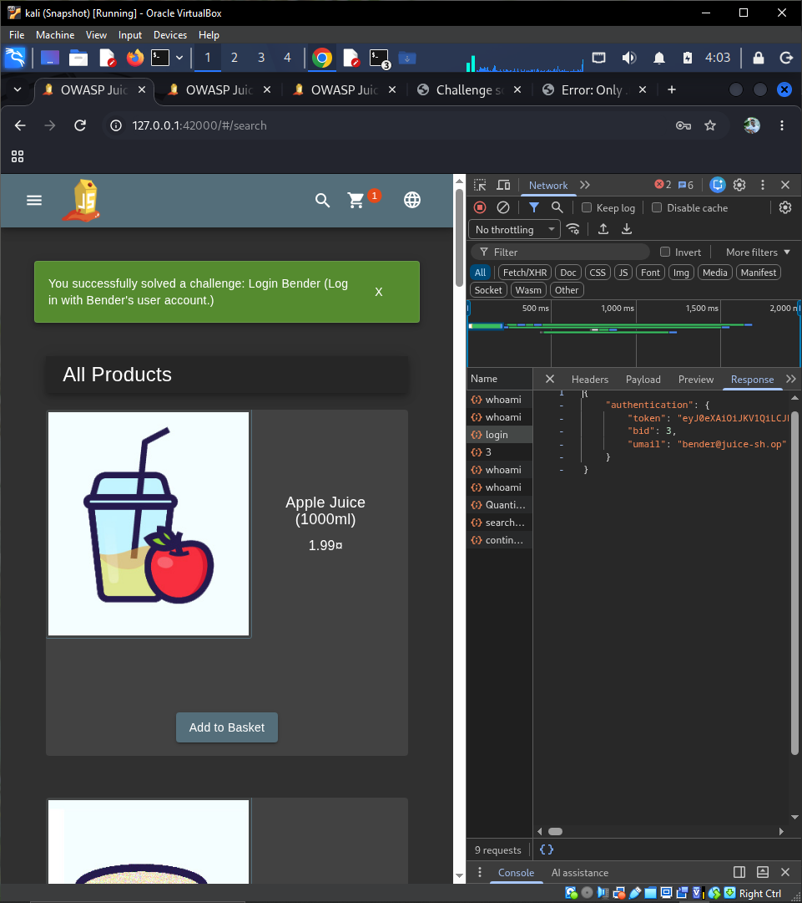
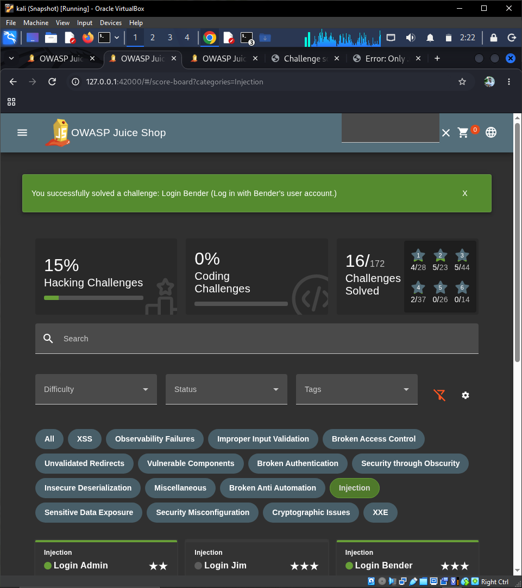

# Injection

OWASP Category: **A03:2021 – Injection**

This category covers vulnerabilities where untrusted user input is passed directly into an interpreter (SQL, NoSQL, OS commands, templates, etc.) without proper validation or sanitization, allowing an attacker to alter the intended logic of a query or command.

Challenges attempted in this category: **11** (3 chatbot-based challenges — Chatbot Prompt Injection, Greedy Chatbot Manipulation, System Prompt Extraction — are not available on our instance due to the LLM backend not being configured, consistent with the AI Debugging challenge being blocked in Broken Access Control. These are documented below as blocked.)

---

## 1. Login Admin ✅ (Solved)

## Difficulty: ⭐⭐
**Description:** Log in with the administrator's user account.

### Vulnerability

The login endpoint builds a SQL query by directly concatenating user-supplied input instead of using parameterized queries. This makes it vulnerable to SQL Injection, allowing an attacker to manipulate the query's logic.

A typical backend login query looks like:

```sql
SELECT * FROM Users WHERE email = '<input>' AND password = '<hashed password>'
```

Because the application does not sanitize the `email` field, special SQL characters (like a single quote `'`) are interpreted as part of the query syntax rather than as plain text.

### Exploitation Steps

1. Navigated to the Login page: `http://127.0.0.1:42000/#/login`
2. In the **Email** field, entered the following payload:
   ```
   admin@juice-sh.op'--
   ```
3. In the **Password** field, entered any arbitrary value (e.g. `x`), since it would be ignored.
4. Clicked **Log in**.

### Why It Works

The `'` closes the string literal early, and `--` starts a SQL comment, causing everything after it (including the password check) to be ignored by the database. The query effectively becomes:

```sql
SELECT * FROM Users WHERE email = 'admin@juice-sh.op'
```

This returns the admin user's row without requiring their actual password, logging the attacker in as the administrator.

### Verification

Confirmed via Chrome DevTools (Network tab):
- The `login` request returned **HTTP 200** (previously 401 on a failed attempt).
- The Response body contained a valid JWT `token` along with `"umail": "admin@juice-sh.op"`, confirming authentication as the admin account.
- The Juice Shop score board marked **Login Admin** as solved (green checkmark).

### Screenshots

| # | File | Description |
|---|------|-------------|
| 1 | `screenshots/injection/01-login-admin-form.PNG` | Login form with the SQL injection payload entered into the Email field, prior to submission |
| 2 | `screenshots/injection/02-login-admin-devtools-payload.PNG` | DevTools Network → Payload tab, showing the exact payload sent to the server |
| 3 | `screenshots/injection/03-login-admin-devtools-response.PNG` | DevTools Network → Response tab, showing the returned JWT token and `admin@juice-sh.op` session |
| 4 | `screenshots/injection/04-login-admin-solved.PNG` | Score board confirming the Login Admin challenge solved |


### Mitigation

- Use parameterized queries / prepared statements (or an ORM that does this by default) instead of string concatenation.
- Apply strict input validation on authentication fields.
- Avoid exposing detailed database/query errors to the client.

---

## 2. Login Bender ✅ (Solved)

## Difficulty: ⭐⭐⭐
**Description:** Log in with Bender's user account.

### Vulnerability

Same root cause as Login Admin: the login endpoint is vulnerable to SQL Injection because user input is concatenated directly into the SQL query instead of being parameterized. The additional difficulty in this challenge is that Bender's email address is not given — it has to be discovered first.

### Reconnaissance

Having already solved **Login Admin**, we gained access to the `/#/administration` panel. This page lists every registered user's email address directly, including `bender@juice-sh.op`. This is itself a privilege-escalation chain worth noting: one vulnerability (SQL injection into an admin session) exposed information (the full user list) that made the next vulnerability easier to exploit.

### Exploitation Steps

1. Logged in as admin (from the previous challenge) and navigated to `http://127.0.0.1:42000/#/administration`.
2. Located Bender's email address in the **Registered Users** list: `bender@juice-sh.op`.
3. Navigated to the Login page: `http://127.0.0.1:42000/#/login`
4. In the **Email** field, entered the following payload:
   ```
   bender@juice-sh.op'--
   ```
5. In the **Password** field, entered any arbitrary value (e.g. `x`).
6. Clicked **Log in**.

### Why It Works

Identical mechanism to Login Admin — the `'` closes the string literal and `--` comments out the rest of the query (including the password check), so the query effectively becomes:

```sql
SELECT * FROM Users WHERE email = 'bender@juice-sh.op'
```

returning Bender's user row and logging the attacker in as Bender without his password.

### Verification

Confirmed via Chrome DevTools (Network tab):
- The `login` request returned **HTTP 200**.
- The Response body contained a valid JWT `token` along with `"umail": "bender@juice-sh.op"`.
- The Juice Shop score board displayed the green "Login Bender" success banner and marked the challenge as solved.

### Screenshots

| # | File | Description |
|---|------|-------------|
| 5 | `screenshots/injection/05-login-bender-admin-panel-emails.PNG` | Administration panel listing registered users, used to find Bender's email |
| 6 | `screenshots/injection/06-login-bender-form.PNG` | Login form with the SQL injection payload entered into the Email field |
| 7 | `screenshots/injection/07-login-bender-devtools-response.PNG` | DevTools Network → Response tab, showing the returned JWT token and `bender@juice-sh.op` session |
| 8 | `screenshots/injection/08-login-bender-solved.PNG` | Score board confirming the Login Bender challenge solved |






### Mitigation

- Use parameterized queries / prepared statements instead of string concatenation.
- Restrict the Administration panel's user list to not expose full email addresses to any authenticated admin without additional safeguards (principle of least exposure).
- Apply strict input validation on authentication fields.

---

*(Remaining challenges — Login Jim, Database Schema, Christmas Special, Ephemeral Accountant, NoSQL DoS, NoSQL Manipulation, User Credentials, NoSQL Exfiltration, SSTi — to be appended below as they are solved.)*

---

## 3. Login Jim ✅ (Solved)

## Difficulty: ⭐⭐⭐
**Description:** Log in with Jim's user account.

### Vulnerability

Same SQL Injection flaw in the login endpoint as the previous two challenges. Jim's email, like Bender's, is not handed to the player directly and had to be found through reconnaissance.

### Reconnaissance

Jim's email address, `jim@juice-sh.op`, was already visible in the same Administration → Registered Users list used to find Bender's email in the previous challenge (accessible after solving Login Admin).

### Exploitation Steps

1. Navigated to the Login page: `http://127.0.0.1:42000/#/login`
2. In the **Email** field, entered the following payload:
   ```
   jim@juice-sh.op'--
   ```
3. In the **Password** field, entered any arbitrary value (e.g. `x`).
4. Clicked **Log in**.

### Why It Works

Same mechanism as the previous two challenges — the `'` closes the string literal and `--` comments out the rest of the query, so it effectively becomes:

```sql
SELECT * FROM Users WHERE email = 'jim@juice-sh.op'
```

returning Jim's user row and logging the attacker in as Jim without his password.

### Verification

- The Juice Shop UI displayed the green "Login Jim" success banner confirming the challenge solved.
- The score board (filtered to the Injection category) shows **Login Admin**, **Login Bender**, and **Login Jim** all marked solved — 17/172 total challenges solved overall at this point.

### Screenshots

| # | File | Description |
|---|------|-------------|
| 9 | `screenshots/injection/09-login-jim-form.png` | Login form with the SQL injection payload entered into the Email field |
| 10 | `screenshots/injection/10-login-jim-devtools-response.png` | DevTools Network → Response tab, showing the returned JWT token and `jim@juice-sh.op` session |
| 11 | `screenshots/injection/11-login-jim-solved.png` | Score board showing the "Login Jim" success banner and challenge marked solved |


### Mitigation

- Use parameterized queries / prepared statements instead of string concatenation.
- Apply strict input validation on authentication fields.
- Limit exposure of full user lists (including emails) even to admin-level panels where not strictly necessary.

---

*(Remaining challenges — Database Schema, Christmas Special, Ephemeral Accountant, NoSQL DoS, NoSQL Manipulation, User Credentials, NoSQL Exfiltration, SSTi — to be appended below as they are solved.)*
