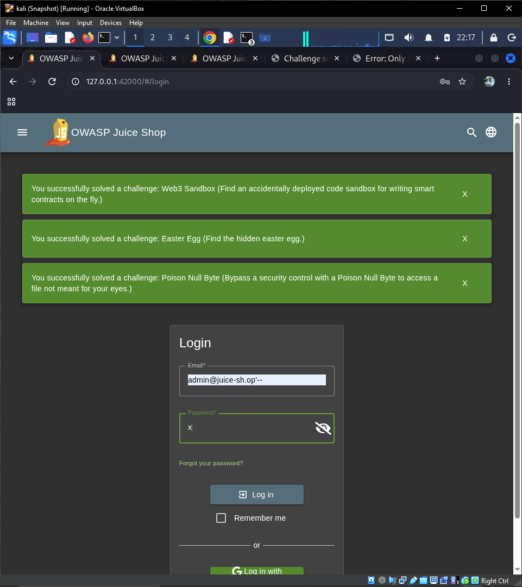
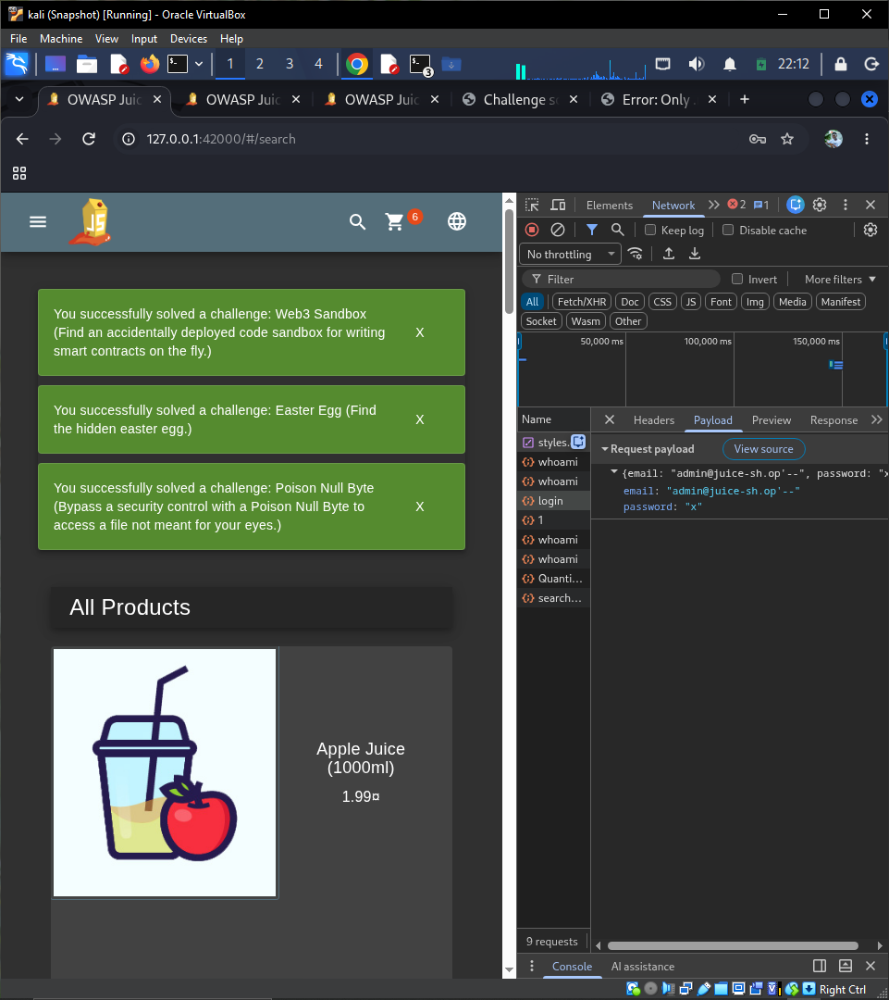
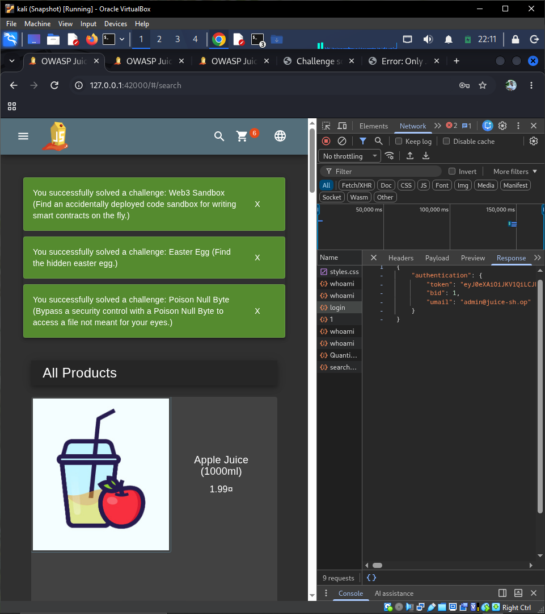
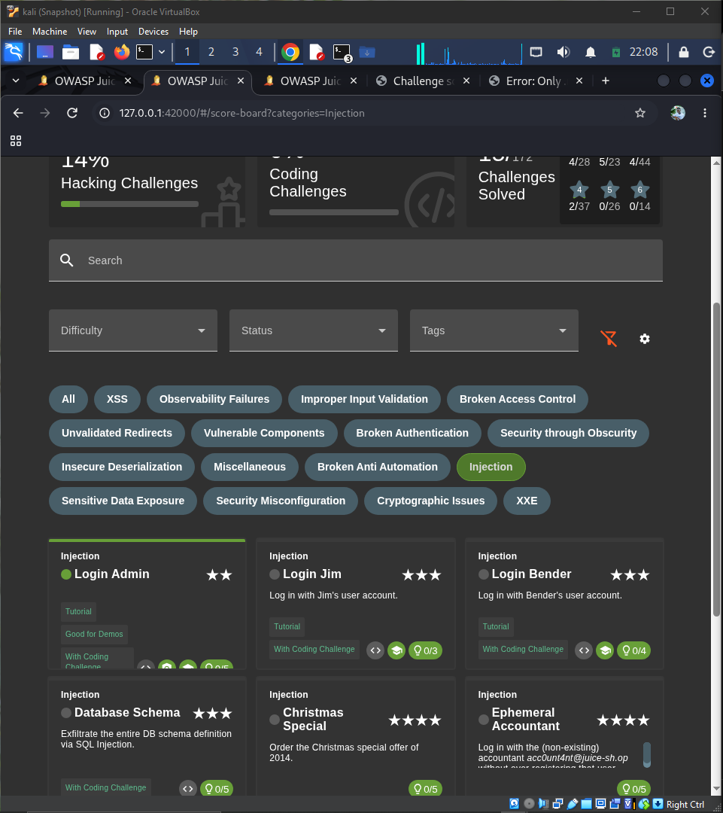

# Injection

OWASP Category: **A03:2021 – Injection**

This category covers vulnerabilities where untrusted user input is passed directly into an interpreter (SQL, NoSQL, OS commands, templates, etc.) without proper validation or sanitization, allowing an attacker to alter the intended logic of a query or command.

Challenges attempted in this category: **11** (3 chatbot-based challenges — Chatbot Prompt Injection, Greedy Chatbot Manipulation, System Prompt Extraction — are not available on our instance due to the LLM backend not being configured, consistent with the AI Debugging challenge being blocked in Broken Access Control. These are documented below as blocked.)

---

## 1. Login Admin ✅ (Solved)

**Difficulty:** ★★
**Description:** Log in with the administrator's user account.

### Vulnerability

The login endpoint builds a SQL query by directly concatenating user-supplied input instead of using parameterized queries. This makes it vulnerable to SQL Injection, allowing an attacker to manipulate the query's logic.

A typical backend login query looks like:

```sql
SELECT * FROM Users WHERE email = '<input>' AND password = '<hashed password>'
```

Because the application does not sanitize the `email` field, special SQL characters (like a single quote `'`) are interpreted as part of the query syntax rather than as plain text.

### Exploitation Steps

1. Navigated to the Login page: `http://127.0.0.1:42000/#/login`
2. In the **Email** field, entered the following payload:
   ```
   admin@juice-sh.op'--
   ```
3. In the **Password** field, entered any arbitrary value (e.g. `x`), since it would be ignored.
4. Clicked **Log in**.

### Why It Works

The `'` closes the string literal early, and `--` starts a SQL comment, causing everything after it (including the password check) to be ignored by the database. The query effectively becomes:

```sql
SELECT * FROM Users WHERE email = 'admin@juice-sh.op'
```

This returns the admin user's row without requiring their actual password, logging the attacker in as the administrator.

### Verification

Confirmed via Chrome DevTools (Network tab):
- The `login` request returned **HTTP 200** (previously 401 on a failed attempt).
- The Response body contained a valid JWT `token` along with `"umail": "admin@juice-sh.op"`, confirming authentication as the admin account.
- The Juice Shop score board marked **Login Admin** as solved (green checkmark).

### Screenshots

| # | File | Description |
|---|------|-------------|
| 1 | `screenshots/injection/01-login-admin-form.PNG` | Login form with the SQL injection payload entered into the Email field, prior to submission |
| 2 | `screenshots/injection/02-login-admin-devtools-payload.PNG` | DevTools Network → Payload tab, showing the exact payload sent to the server |
| 3 | `screenshots/injection/03-login-admin-devtools-response.PNG` | DevTools Network → Response tab, showing the returned JWT token and `admin@juice-sh.op` session |
| 4 | `screenshots/injection/04-login-admin-solved.PNG` | Score board confirming the Login Admin challenge solved |






### Mitigation

- Use parameterized queries / prepared statements (or an ORM that does this by default) instead of string concatenation.
- Apply strict input validation on authentication fields.
- Avoid exposing detailed database/query errors to the client.

---

*(Remaining challenges — Login Bender, Login Jim, Database Schema, Christmas Special, Ephemeral Accountant, NoSQL DoS, NoSQL Manipulation, User Credentials, NoSQL Exfiltration, SSTi — to be appended below as they are solved.)*
