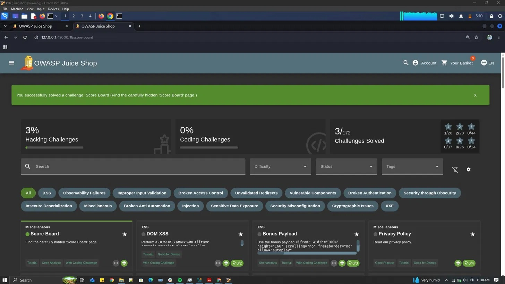

# Score Board: Broken Access Control / Security Through Obscurity

## Challenge: Score Board

## Difficulty: ⭐

## Category: Miscellaneous (listed under Security Through Obscurity in OWASP terms)

## Goal: Find the carefully hidden "Score Board" page.

### Steps Taken
1. Observed that no link to a score board existed anywhere in the site's visible navigation menu.
2. Guessed a likely route based on common naming conventions used by developers.
3. Navigated directly to: `http://127.0.0.1:42000/#/score-board`
4. The page loaded successfully, revealing the full challenge tracker with 172 total challenges, categorized by type and difficulty.

### Why It Worked
The Score Board route exists and is fully functional on the server/frontend, but it is never linked anywhere in the application's UI. This is a textbook example of **"security through obscurity"** — relying on a page being hard to find, rather than actually restricting access to it. Since there is no authentication or authorization check on this route, anyone who guesses, brute-forces, or discovers the URL (e.g., via a `robots.txt` disclosure, JavaScript source inspection, or simple guessing) can access it freely.

### Impact
While the Score Board itself isn't sensitive data, the underlying lesson generalizes to real applications: any hidden admin page, debug panel, or internal tool that relies only on "nobody knows the URL" rather than genuine access control is one guess or search-engine crawl away from being exposed. In a real-world app, a similarly "hidden" page could expose internal tools, user data, or admin functionality.

### Remediation
- Enforce proper authentication/authorization checks server-side on any route not meant for public use, regardless of whether it's linked in the UI.
- Never rely on obscurity (unlisted URLs) as a security control.
- Disallow indexing of sensitive paths via `robots.txt` only as a secondary measure not a substitute for real access control.

### Screenshot

